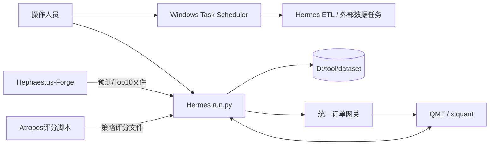
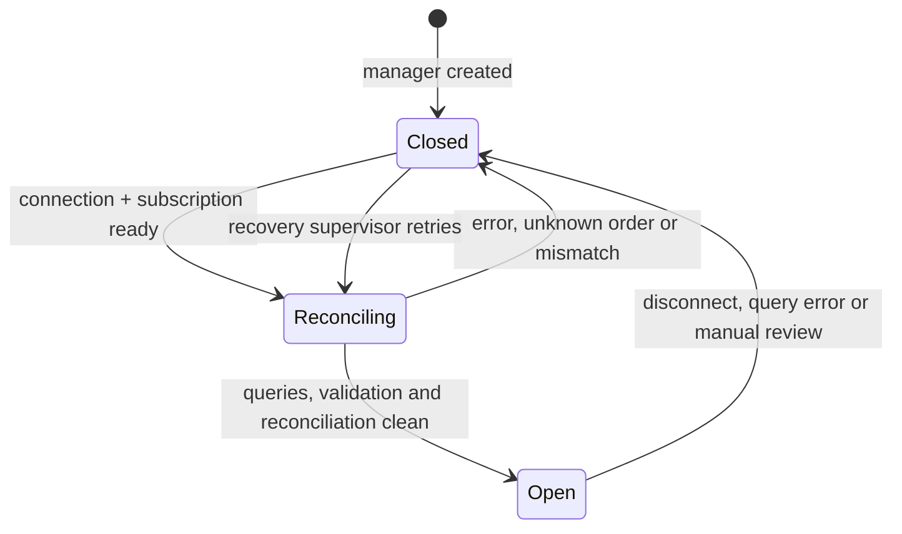

# Hermes 架构说明

> **Document type:** system architecture
> **Audience:** agents, developers, operators, reviewers
> **Scope:** 当前 Hermes 线上执行服务；不包含 Hephaestus-Forge 内部训练实现
> **Authoritative code:** `run.py`, `execution/`, `conf/config.ini`
> **Reviewed:** 2026-11-17

## 1. 系统定位

Hermes 是线上策略执行和交易控制服务，负责连接 QMT/xtquant、加载已启用策略、消费共享数据和外部模型产物、生成标准订单意图，并通过订单协议、风险检查和恢复对账控制提交。

Hermes 不负责离线模型训练、模型评估或大规模训练数据缓存。相关工作属于：

```text
D:/tool/pycharm_workspace/Hephaestus-Forge
```

Hermes 与外部项目通过文件、命令行进程和明确的输出产物交互，不共享内部训练实现。

## 2. C4 风格上下文



### 系统边界

| 边界 | Hermes 负责 | 外部系统负责 |
|---|---|---|
| 交易连接 | 连接、订阅、网关适配、回调和恢复 | QMT 客户端、券商账户和权限 |
| 策略运行 | 调度已配置策略、读取产物、生成订单意图 | Hep/Atropos 生成模型/评分产物 |
| 数据准备 | 仓库内 ETL 脚本和策略输入 | Windows 任务调度、原始行情源 |
| 训练 | 不负责 | Hephaestus-Forge |
| 账户审计 | 本地订单、成交和对账状态 | 券商侧真实订单和资产快照 |

## 3. 进程和模块

```mermaid
flowchart TD
    Run[run.py] --> Pre[check_and_update_data]
    Run --> Manager[MicroserviceManager]
    Manager --> Accounts[账户初始化]
    Accounts --> QMT[XtQuantTrader]
    Accounts --> Protocol[OrderManager + SQLiteOrderStore]
    Accounts --> Gateway[GatewayRouter / XtQuantGateway]
    Accounts --> Recovery[AccountRecoveryCoordinator + QmtRecoverySupervisor]
    Manager --> Services[StrategyManagementService]
    Services --> Dynamic[importlib 动态加载]
    Dynamic --> Strategy[Strategy class / do(accounts)]
    Strategy --> Managed[ManagedTrader compatibility facade]
    Managed --> Protocol
    Protocol --> Risk[RiskManager]
    Protocol --> Gateway
    QMT --> Callback[XtQuantCallbackBridge]
    Callback --> Protocol
```

### 3.1 `run.py`

当前完整入口是 `run.py`。生命周期：

1. 初始化日志。
2. `check_and_update_data()` 检查行情日期、Hep 预测、DragonV6 和 ThemeMomentum 产物。
3. 创建 `MicroserviceManager`。
4. 读取 `conf/config.ini`，初始化账户和执行组件。
5. 启动连接、订阅和启动对账。
6. 读取 `[strategy] name`，动态加载并实例化策略。
7. 为每个策略创建周期任务。
8. 启动恢复监控和配置观察任务。

`main.py` 是历史简化示例，不具备当前完整账户、订单、风险和恢复生命周期。

### 3.2 策略管理

`StrategyManagementService` 使用 `importlib` 加载配置中的脚本，并按 `name` 查找类。每个策略实例必须提供 `do(accounts)`。默认情况下，上一轮策略任务未结束时会跳过重叠周期。

配置观察只更新已有实例的配置对象，不会安全地重建账户、策略集合或网关。启停策略和关键运行配置变化应重启服务并重新对账。

## 4. 账户与订单状态机

### 4.1 账户初始化

`[client] acc_dict` 提供账户键、账户标识和 QMT `userdata_mini` 路径。初始化会创建：

- `XtQuantTrader` 和账户对象。
- `XtQuantGateway`、`GatewayRouter`。
- `SQLiteOrderStore`、`OrderManager`。
- `XtQuantCallbackBridge`。
- `AccountRecoveryCoordinator` 和 `AccountGateController`。

### 4.2 提交闸门



系统默认先关闭提交。只有连接、订阅、订单/成交查询、账户资产和持仓校验、启动对账及风险检查都通过后才允许统一订单路径提交。未知券商订单、缺失本地订单、查询错误或账实不一致会保持关闭并要求人工复核。

### 4.3 订单协议

核心代码位于 `execution/order_protocol.py`：

- `OrderIntent`：策略的标准化意图。
- `OrderManager`：幂等、状态转换、提交、成交去重和对账。
- `OrderRecord`：本地状态。
- `SubmissionResult`、`FillEvent`、`BrokerOrderSnapshot`：网关边界对象。
- `SQLiteOrderStore`：持久化状态。

`execution/managed_trader.py` 将旧 QMT 风格的 `order_stock` 调用转换为 `OrderIntent`，为历史策略提供兼容层。新代码应直接使用统一协议或明确的服务接口。

## 5. 网关、风险和恢复

当前默认网关是 `mini_qmt`，实现位于 `execution/xtquant_gateway.py`，路由位于 `execution/multi_gateway.py`。代码保留 Paper、Manual、PTrade、FIX、Broker API、Algo 和 CTP 的扩展接口，是否可用取决于客户端和账户权限。订单账本目录必须由 `conf/config.ini` 的 `[execution] order_store_dir` 显式提供。

`execution/risk.py` 的风险限制在没有对应 `[execution]` 配置时使用代码默认值；订单账本目录不适用默认值，必须显式配置：

- 单笔订单权益比例：25%。
- 总持仓权益比例：100%。
- 保证金权益比例：40%。
- 单笔数量：1,000,000。

`AccountRecoveryCoordinator` 负责一次对账，`QmtRecoverySupervisor` 负责断线重连和再次校验，`AccountGateController` 保持账户状态、订单管理器和兼容层闸门一致。

## 6. 当前活动策略

活动集合只由当前部署副本 `conf/config.ini` 的 `[strategy] name` 决定。本文不复制具体活动名称，避免配置变更后形成第二个事实源。代理或操作人员需要在变更前后执行以下检查：

1. 读取逗号分隔的策略名称。
2. 为每个名称解析对应 section、脚本路径和周期。
3. 确认脚本路径、配置文件和外部输入均存在且属于预期版本。
4. 对照运行日志确认实例集合与配置一致。
5. 将配置版本、输入日期和验证结果写入变更记录。

配置中保留的历史 section 或策略脚本不会自动加载。策略实现必须继续通过 `OrderManager` 或 `ManagedTrader` 提交订单，并遵守启动对账、风险校验和闸门约束。

### 策略输入登记

每个上线策略至少登记以下内容：

| 字段 | 要求 |
|---|---|
| 策略名称与脚本 | 与配置 section 和类名一致 |
| 调度周期 | 明确单位、交易时段和重叠处理 |
| 输入产物 | 路径、生成方、日期/版本校验和缺失处理 |
| 订单边界 | 统一订单协议、风险限制和测试开关 |
| 回滚方式 | 停止策略、关闭闸门、恢复上一配置并重新对账 |
### Top10 外部边界

`Top10V8V1` 在指定时段调用：

```text
python -m top10_ranker.export.run_daily_pipeline_v8 <date> --top-k 10
```

工作目录是 Hephaestus-Forge，结果读取自 `top10_ranker/output/top10_<YYYYMMDD>_v8.csv`。其独立配置 `conf/top10_v8_v1.ini` 当前 `is_test=1`；切换到真实订单前必须完成独立验收。

## 7. 数据和外部进程

启动前数据检查可能调用：

- Hep 的 `inference/generate_all_predictions.py`。
- Atropos 的 `export_v20_scores.py`。
- Atropos 的 `export_theme_momentum_scores.py`。

这些外部调用只生成或更新输入产物，不代表 Hermes 在执行训练。外部任务失败目前记录警告并继续启动，生产运维必须在启动后检查产物和日志。

目录职责、文件命名、保留和删除边界见 [`DATA_CONTRACTS.md`](DATA_CONTRACTS.md)。

## 8. 可观测性和审计

| 类别 | 路径/接口 |
|---|---|
| 服务日志 | `D:/tool/dataset/server_log/app.log` |
| 策略评分 | `D:/tool/pycharm_workspace/Hermes/logs` |
| 订单账本 | `D:/tool/dataset/strategy_positions/orders_<account_key>.sqlite3` |
| 策略状态 | `[strategy] base_dir` 指定的共享目录 |
| 健康状态 | `execution/health.py` 的 `runtime_health()` |

交易问题应同时保留服务日志、策略日志、订单账本、券商订单/成交快照、账户对账报告和模型/评分产物版本。

## 9. 关键不变量

1. 未完成启动对账时不能提交订单。
2. 连接断开、查询出错、账实不一致或人工复核时，提交闸门必须关闭。
3. 相同逻辑订单重复提交必须保持幂等。
4. 重复成交回报不能重复累计成交量。
5. 策略不能绕过 `OrderManager` 或 `ManagedTrader`。
6. Hermes 不运行离线训练。
7. `[strategy] name` 是活动策略的唯一配置入口。

## 10. 已知限制

- 配置和代码包含较多绝对路径，迁移机器需逐项核对。
- 当前执行参数部分来自代码默认值，尚未全部显式化到 `[execution]`。
- 配置观察不会安全重建策略集合或账户连接。
- 旧 MLP 策略脚本仍在 Hermes，但其 `incubate` 依赖已迁移，不应直接重新启用。
- 启动前外部任务失败后会继续启动，关键数据缺失需要运维侧阻断放行。
- 工作区可能包含历史策略、测试脚本、生成文件和未跟踪实验；发布前必须按变更清单核对。
